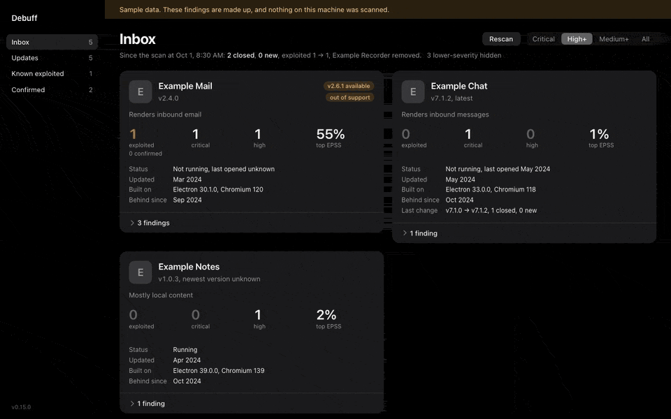
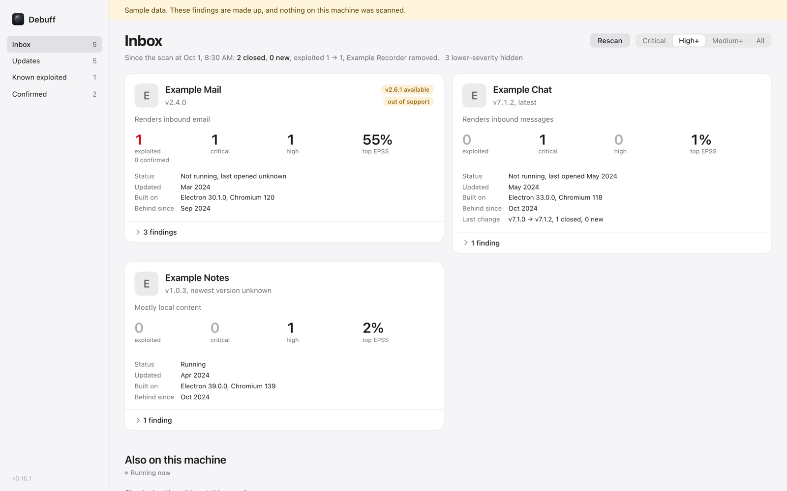
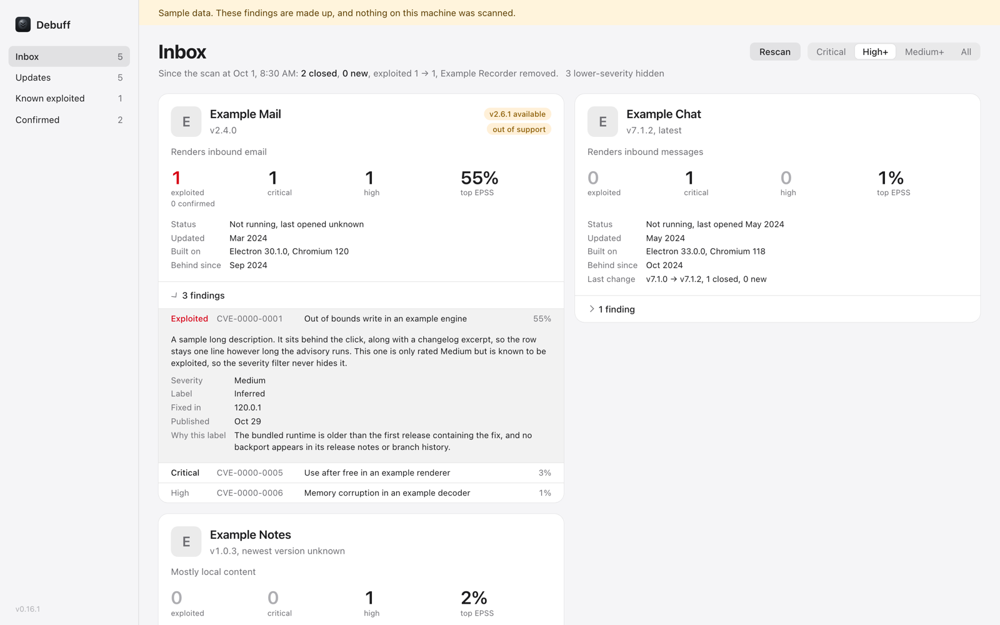
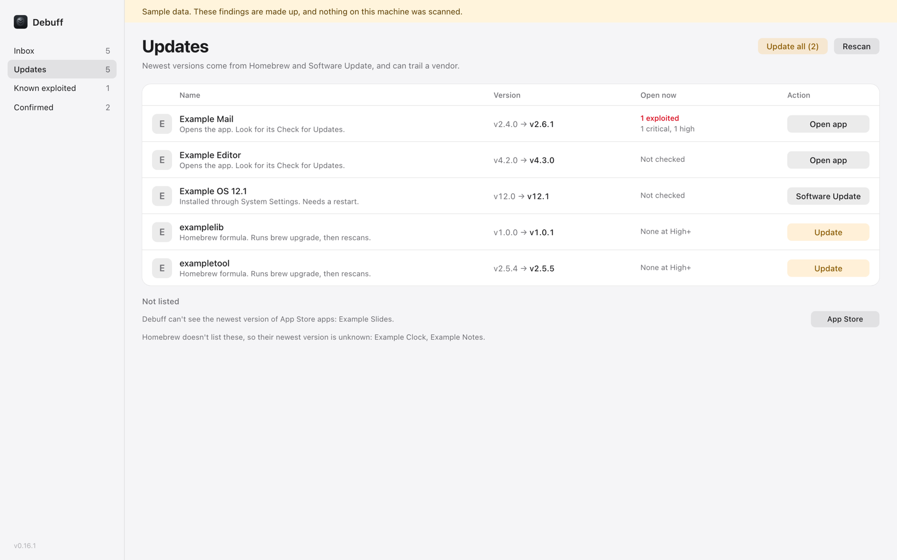
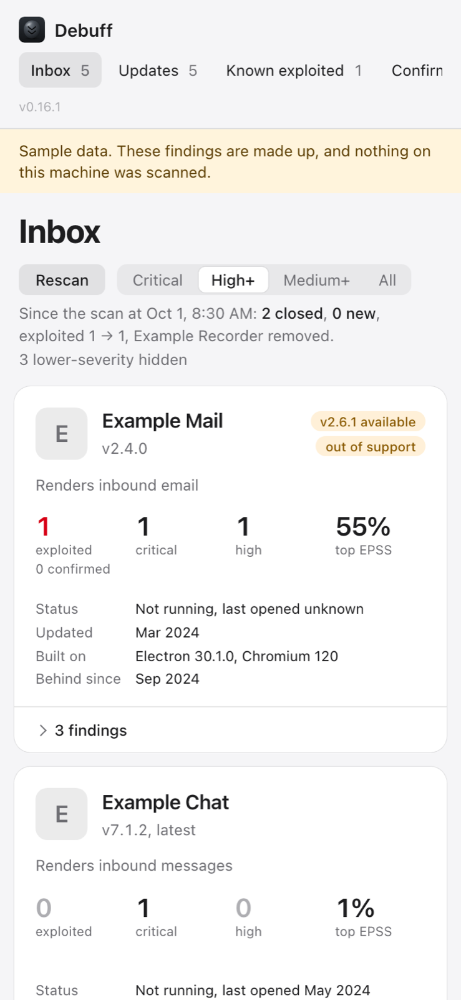

# Debuff

A morning check of your own Mac's vulnerability exposure, opened in a browser tab like a mailbox. Each app
gets a card, ranked by what could actually hurt you, including the bundled runtimes that stock scanners
can't see.



Most Mac vulnerability tools watch a fleet. Debuff watches one machine, yours, and answers three questions:

- **What's open?** Known CVEs in the apps, Homebrew formulae and AI-agent tools installed here.
- **What matters first?** Known-exploited findings lead, then how much untrusted content the app handles,
  then EPSS and severity.
- **What can I do about it?** Whether a newer version exists, and a button that gets you to it.

One binary, one process, one data directory, Go standard library only. It listens on loopback only, sends no
notifications, and changes nothing on your machine until you press an update button.

## Quick start

Requires macOS and Go 1.27.3 or newer. Homebrew is optional but most of the update features use it.

```sh
go install github.com/thwomp-io/debuff/cmd/debuff@latest

debuff serve &     # the console, on http://127.0.0.1:8737
debuff scan        # the first scan takes a couple of minutes; later ones take seconds
debuff open        # opens the console in your browser, signed in
```

To look before scanning anything, `debuff serve --demo` shows made-up sample findings under a banner.

To keep it running and scan every morning at 06:00, install it as a pair of launchd agents from a clone:

```sh
git clone https://github.com/thwomp-io/debuff && cd debuff
brew install just
just deploy        # build, install to ~/.local/bin, start, require a healthy answer
just status        # is it up, and is what's running what's installed?
```

[RUNBOOK.md](RUNBOOK.md) covers running, upgrading, rolling back and removing it.

## What you see

| Inbox | A finding, opened |
|---|---|
|  |  |

| Updates | On a phone-sized window |
|---|---|
|  |  |

All four are the bundled sample data (`debuff serve --demo`). There is a dark theme too; the page follows your
system setting.

- **Inbox**: one card per app with open findings, and a list of everything else on the machine below it.
  A severity control hides Medium and Low by default; a known-exploited finding always shows.
- **Updates**: only what has a newer version, most urgent first, each with one action.
- **Known exploited** and **Confirmed**: the same cards, filtered.
- The line under the title says what changed since the last scan that found something different.

## What it checks

| What | How it's found | Checked against |
|---|---|---|
| Electron apps | The Electron framework inside each app bundle | Chrome Releases, Electron's release notes and branch history, OSV |
| Agent browsers | The Playwright browser cache | Chrome Releases |
| Homebrew formulae | `brew vulns` | OSV |
| Common Mac apps | A shipped registry of bundle IDs ([`apps.json`](internal/registry/apps.json)) | NVD |
| AI-agent tools | Agent CLIs, MCP servers named in agent configs, plugins | OSV |
| Updates | `brew outdated`, Software Update's last result, Homebrew's cask catalog | n/a |

Every finding is also marked if it is on CISA's Known Exploited Vulnerabilities list, and scored with EPSS.

Each finding carries a label that says how sure the match is:

- **Confirmed**: an advisory names this exact version.
- **Inferred**: the bundled runtime is older than the fix and no backport was found. An upper bound: the bug
  may not exist in code that old.
- **Doubtful**: the match looks like it belongs to another project. Hidden unless you ask for All.

An app nothing could check is listed as having no CVE source. That is never shown as clean.

## What leaves your machine

A scan makes read-only requests to public sources: Chrome Releases, chromium.googlesource.com,
releases.electronjs.org, osv.dev, nvd.nist.gov, cisa.gov, first.org and formulae.brew.sh. The requests name
a product and a version (for example "Electron 30.1.0" or "mozilla:firefox 140.0"), never a list of what is
installed, and carry the User-Agent `debuff/<version>`. Version checks read Homebrew's shared catalog, one
file every Homebrew user downloads, so no vendor sees a request about your machine.

Findings, the app inventory, icons and the sign-in token live in `~/.local/state/debuff/`, readable only by
you. Keep that directory out of git and out of shared backups: a list of what is installed and unpatched is
exactly what an attacker would want.

More in [docs/HOW-IT-WORKS.md](docs/HOW-IT-WORKS.md) and [SECURITY.md](SECURITY.md).

## Commands

| Command | What it does |
|---|---|
| `debuff serve [--addr 127.0.0.1:8737] [--demo]` | Runs the console. Refuses any address that isn't loopback |
| `debuff scan [--timing]` | Scans once and writes a snapshot. Prints counts only, so its output is safe to paste |
| `debuff open [--print]` | Opens the console signed in, or prints the URL |
| `debuff health` | Asks a running server whether it's OK |
| `debuff registry check` | Confirms each registry entry's CVE source really answers |
| `debuff version [--json]` | The version, commit and Go toolchain |

Every command takes `--state-dir DIR` (or `$DEBUFF_STATE_DIR`), so you can try anything against a throwaway
directory. Tuning what Debuff knows about your apps is in [docs/CONFIGURATION.md](docs/CONFIGURATION.md).

## Limits

- macOS only.
- Coverage is partial and the page says where: App Store apps, and apps with no registry entry, have no CVE
  source yet.
- Inferred findings are upper bounds, often large ones for an app on an old Electron line.
- Homebrew casks are never upgraded from the page. A cask's uninstall step can quit a running app before an
  install that then needs `sudo`. The button opens the app instead.
- It reports. What you do about a finding is your call.

## Contributing

[CONTRIBUTING.md](CONTRIBUTING.md) for people, [AGENTS.md](AGENTS.md) for coding agents. `just check` runs
every check.

## License

Apache-2.0. See [LICENSE](LICENSE).
